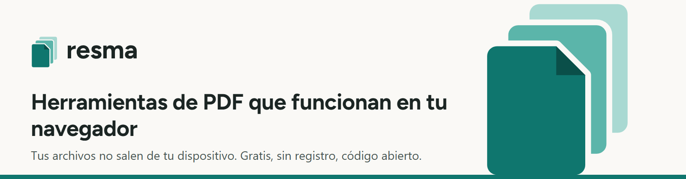
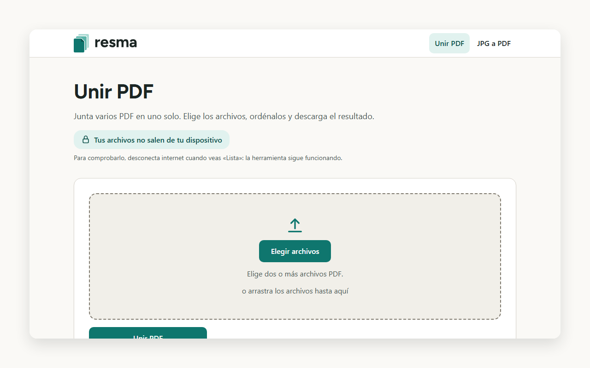
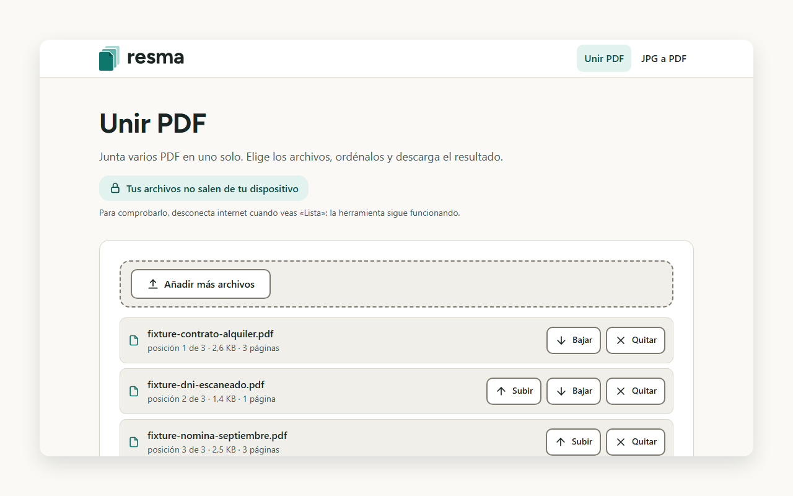
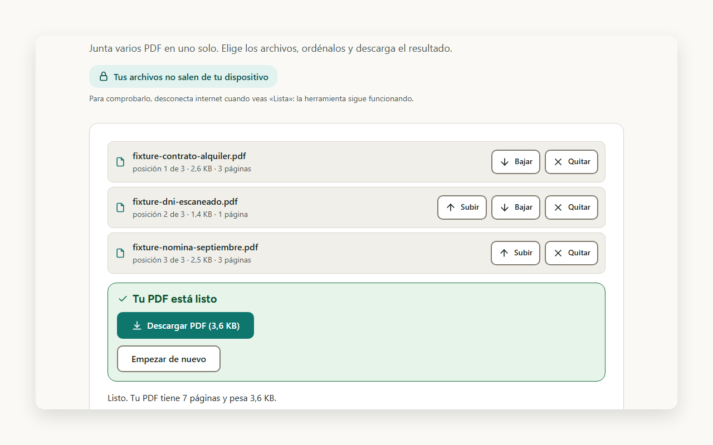
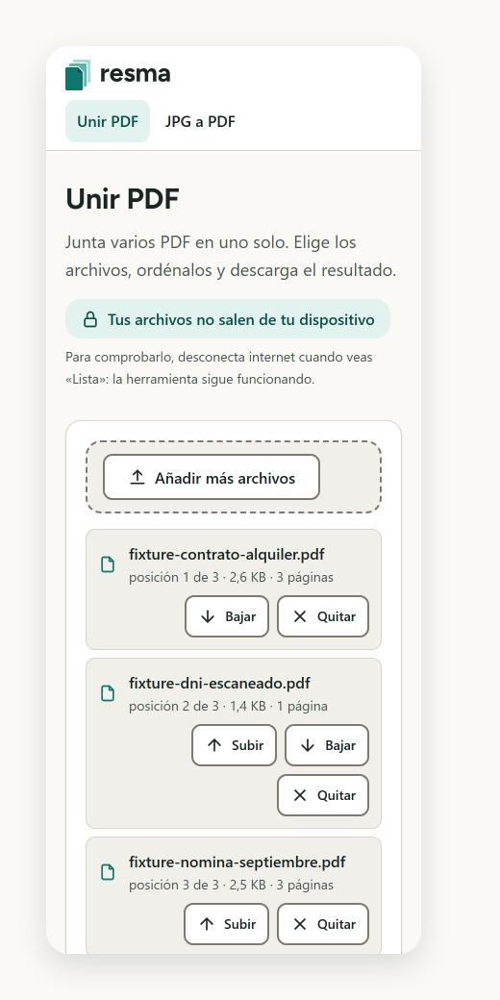
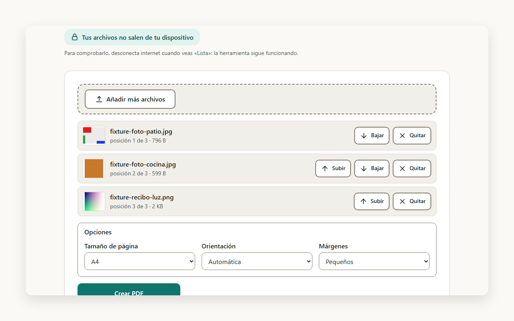

<picture>
  <source media="(prefers-color-scheme: dark)" srcset="media/readme-header-dark.png">
  
</picture>

resma is a free, open-source set of PDF tools that run entirely in your browser: merge several PDFs into one, or turn JPG and PNG images into a single PDF. Your files never leave your device, and there is no sign-up, ads or cookies. The interface is in Spanish, written for people in Spain and Mexico.



## Tools

- **Unir PDF** merges two or more PDF files into one, in the order you choose.
- **JPG a PDF** turns JPG and PNG images into one PDF, with page size, orientation and margin options.

| Files added | Result | Phone |
| --- | --- | --- |
|  |  |  |



## How it works

The site is a set of static pages. The PDF work happens in a web worker inside your browser, so nothing is uploaded and the tools keep working when you disconnect from the internet after the page has loaded. The site sets no cookies and stores nothing of its own on your device; besides its ordinary cache, the browser keeps Cloudflare's network-error instruction described on the privacy page. The server-side records are the technical access log of the host that serves the pages and, only when a request to the site fails, a network error report that the visitor's browser sends to Cloudflare; the privacy page describes both.

## Build

You need Node.js 24 (the build checks it) and Python 3 (built and tested with 3.14). The only runtime dependency is `@cantoo/pdf-lib`, pinned to an exact version in `package-lock.json`.

```
npm ci --ignore-scripts
python -I tools/build.py
```

The build writes the static site to `dist/` and checks the size budgets of each page. `dist/` is not committed.

## Security

To report a vulnerability, write to resma@aiskaron.com. See [SECURITY.md](SECURITY.md) for what is in scope.

## Changes

See [CHANGELOG.md](CHANGELOG.md).

## Licence

MIT, see [LICENSE](LICENSE). Third-party components and their licences are listed on the site's `/licencias/` page.

resma is a project of AIskaron.
